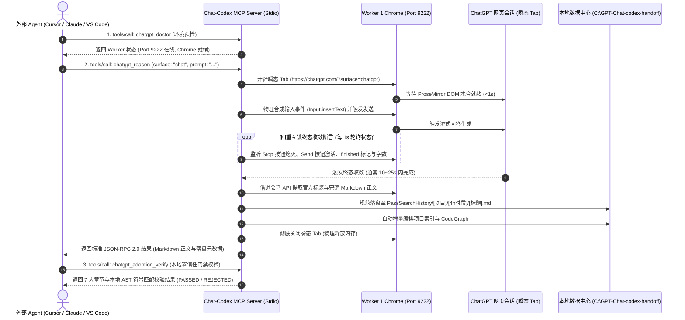

# Chat-Codex

> **工业级 Chrome CDP 驱动的 ChatGPT Pro 跨工作区智能体桥接与桌面控制中枢**  
> *Native Node.js • Zero Compilation • Pure CDP Protocol • Stdio MCP Server • Desktop Studio*

[](https://nodejs.org/)
[](https://chromedevtools.github.io/devtools-protocol/)
[](https://modelcontextprotocol.io/)
[](#8-质量保障与自动化测试)
[](#)

---

## 1. 为什么选择 Chat-Codex (Vision & Positioning)

在当前大模型 Agent 落地过程中，开发者往往面临两大痛点：**云端商业 API 成本极高且功能受限（缺少最新的联网搜索与深度思考能力）**，而**人工在 ChatGPT 网页端复制粘贴又无法形成自动化闭环**。

**Chat-Codex** 彻底打破了这一壁垒。它通过轻量级原生 Chrome DevTools Protocol (CDP)，直接接管本地已授权的 ChatGPT Pro 浏览器沙盒，将 ChatGPT 深度推理能力转化为标准的 **Stdio JSON-RPC 2.0 MCP (Model Context Protocol) 服务** 与 **统一命令行 (CLI)**，供 Cursor、Claude Code、VS Code (Cline / Roo)、Antigravity 等任意独立工作区的 Agent 秒级调用。

### 🌟 核心工程特性
- ⚡ **秒级极速响应 (Chat-First)**：日常小任务、代码片段评审与咨询默认走 `surface: "chat"`，结合四重互锁终态收敛断言，**10~25 秒内极速返回**。
- 🧹 **瞬态沙盒物理回收**：每次任务均开辟独立瞬态 Tab，输入框 ProseMirror 水合后注入 Prompt，流式收敛提取 Markdown 后**立即销毁 Tab，物理释放内存**，绝无后台内存泄漏。
- 🛡️ **本地零信任采纳门禁 (Zero-Trust Gate)**：内置 7 大章节结构契约（Verdict, Assumptions, Evidence Used, Proposed Changes, Tests, Risks, Unknowns）、AST 符号核验与 Git Worktree 影子沙盒测试，杜绝模型幻觉直接污染代码。
- 🖥️ **独立原生桌面客户端**：内置已编译就绪的原生客户端 `chat-codex-studio.exe` 及轻量级 HTTP/SSE 桌面服务（Port 8765），提供 10 路错峰梯度大盘、翻牌计数器与研报代码审阅。
- 🔒 **零特权凭据安全架构**：针对 Chrome 127+ ~ 152+ 的 Windows App-Bound 加密，彻底摒弃需要 UAC 管理员权限的 VSS 卷影机制，采用 **CDP 纯内存 105ms 零特权热同步**，安全且无痛。
- 📚 **三级时段知识库与 CodeGraph**：所有推理成果自动归档至 `PassSearchHistory/[项目]/[4h时段]/[标题].md`，并实时增量构建项目知识索引与 `codegraph.json`。

---

## 2. 端到端系统架构与工作时序 (Architecture)



---

## 3. 工作区红黄绿目录导航 (Directory Anatomy)

为防止外部 Agent 或开发者迷路，本项目遵循严格的红黄绿分类原则：

```text
C:\code\Chat-Codex\
│
├── 🟢 生产主干（核心代码与执行入口，日常开发与集成唯一关注区）
│   ├── handoff-core\                           # [核心主干] 所有生产流水线、MCP 服务与 CLI
│   │   ├── bin\handoff.js                      # 统一 CLI 生产总入口 (doctor | chat | sync | index | gui | mcp)
│   │   ├── mcp\                                # 标准 Stdio JSON-RPC 2.0 MCP 协议服务实现
│   │   ├── gui\                                # 轻量 HTTP + SSE 原生桌面服务 (Port 8765)
│   │   ├── pipeline\                           # 核心自动化调度流水线 (auto_chat_pipeline.js 等)
│   │   ├── lib\                                # 核心底层库 (surface_manager, cdp-cookie-manager 等)
│   │   └── tests\offline\                      # 43 个纯离线确定性单元测试 (100% 全部通过)
│   ├── chat-codex-studio.exe                   # [已编译] 原生桌面独立控制台可执行程序
│   ├── start_gui.bat                           # 桌面控制台一键启动批处理
│   ├── start_sub1.bat                          # Worker 1 实例拉起脚本 (Port 9222)
│   └── start_sub2.bat                          # Worker 2 实例拉起脚本 (Port 9223)
│
├── 🔵 活跃沙盒与数据中心（受保护的运行态，严禁随意删除或重命名！）
│   ├── sub-instance-1\ (Port 9222)             # Worker 1 Chrome 活跃沙盒 (已绑定保活)
│   ├── sub-instance-2\ (Port 9223)             # Worker 2 Chrome 活跃沙盒 (已绑定保活)
│   └── C:\GPT-Chat-codex-handoff\              # 全局统一运行时数据中心 (Master凭据、历史研报、锁)
│
├── 🟡 文档、教程与 Agent 规范（查阅与对接指南）
│   ├── README.md                               # [本文档] 项目总览、架构全景与快速上手
│   ├── AGENTS.md                               # 跨工作区 Agent 快速调用与提示词契约规范
│   ├── 调用教程/README.md                      # [调用教程] 针对外部 Agent 与 IDE 的实战配置与调用教程
│   ├── 调用教程.md                             # 根目录快速入口镜像
│   └── docs/                                   # 7 大架构设计规范与历史攻关知识库
│
└── 🔴 上游独立参考与历史归档（仅供只读参考，严禁盲目扫描、全文检索或执行！）
    ├── codex-bridge-chatgpt\                   # 上游参考 1：契约包规范 (Context Packet Schema)
    ├── codex-chatgpt-pro-plugin\               # 上游参考 2：原生 CDP 驱动与跨进程文件锁参考
    └── handoff-core\experiments\legacy\        # 历史攻关脚本归档镜像 (65 个攻关脚本，已做过期标记)
```

---

## 4. 极速 10 秒上手指南 (Quick Start)

系统为**纯原生 Node.js 驱动，零外部编译步骤**，开箱即用：

### 步骤 1：启动 Worker 1 浏览器沙盒
双击运行根目录下的 `start_sub1.bat`（或在终端运行）：
```powershell
cmd /c C:\code\Chat-Codex\start_sub1.bat
```
*提示：首次使用时，请在弹出的 Chrome 窗口中人工完成一次 ChatGPT 登录。登录态将被持久化复用。*

### 步骤 2：环境毫秒级自检
```powershell
node C:\code\Chat-Codex\handoff-core\bin\handoff.js doctor --browser
```
输出中只要确认 `port: 9222` 状态为 `online`，即代表系统完全就绪。

### 步骤 3：发起一次纯 Chat 模式极速推理
```powershell
node C:\code\Chat-Codex\handoff-core\bin\handoff.js chat --prompt "请用一句话解释TCP三次握手的核心目的" --surface chat
```
终端将在约 10~15 秒内输出生成结果，并自动落盘至 `C:\GPT-Chat-codex-handoff\PassSearchHistory\`。

### 步骤 4：启动可视化控制大盘
双击运行 `start_gui.bat`（或直接运行 `chat-codex-studio.exe`），即可在浏览器或桌面视窗中访问 `http://localhost:8765`，实时监控 Worker 状态与错峰梯度任务流。

---

## 5. 跨工作区 MCP 服务配置 (MCP Integration)

在你的 IDE（如 Cursor、Claude Desktop、VS Code Cline/Roo、Antigravity）的 MCP 配置文件中添加如下配置，即可直接调用 6 大核心 MCP 工具：

```json
{
  "mcpServers": {
    "chat-codex": {
      "command": "node",
      "args": [
        "--dns-result-order=ipv4first",
        "C:\\code\\Chat-Codex\\handoff-core\\bin\\handoff.js",
        "mcp"
      ],
      "env": {
        "NODE_OPTIONS": "--dns-result-order=ipv4first",
        "HANDOFF_CONFIG": "C:\\GPT-Chat-codex-handoff\\runtime.local.json"
      }
    }
  }
}
```

### 核心 MCP 工具一览：
| 工具名称 | 核心用途 | 关键参数建议 |
|---|---|---|
| **`chatgpt_doctor`** | 毫秒级预检 CDP 端口与登录态 | `{ "checkBrowser": true }` |
| **`chatgpt_reason`** | 发起推理（默认秒级 Chat 模式） | `{ "prompt": "...", "surface": "chat" }`（支持 `asyncHandle: true` 防超时） |
| **`chatgpt_upload_context`**| 本地代码扫描脱敏打包为单文件 | `{ "projectRoot": "...", "maxFileBytes": 100000 }` |
| **`chatgpt_adoption_verify`**| 7大章节与本地 AST 符号采纳门禁 | `{ "resultMarkdown": "...", "dryRunPatch": false }` |
| **`chatgpt_surface_manage`**| 动态查询/切换表面与思考深度档位 | `{ "action": "configure", "targetSurface": "chat", "effort": "high" }` |
| **`chatgpt_session_manage`**| 会话房间隔离 (`main`/`debug`/`critic`) | `{ "action": "switch", "roomId": "critic" }` |

*完整详细参数规格与调用示例，请查阅 [调用教程/README.md](调用教程/README.md)。*

---

## 6. Agent 交互契约与零信任门禁 (Agent Contracts)

外部 Agent 调用本系统时，建议遵循以下提示词契约规范，以获得确定性最高的结构化输出：

### 6.1 出站出题包规范 (`BEGIN_CONTEXT_PACKET`)
```markdown
BEGIN_CONTEXT_PACKET
packet_id: <唯一任务ID>
requested_reasoner: default

## Objective
<单一明确的技术决策或具体的故障表现>

## Acceptance
- <客观可观察的验收指标，如某个离线测试通过>

## Evidence
- <精确到 file:symbol 的关键代码片段与局部错误堆栈>

## Constraints
- <兼容性红线、改动范围限制，严禁泄漏敏感凭据>

## Questions
1. <向外部专家提出的 1~2 个核心技术问题>
END_CONTEXT_PACKET
```

### 6.2 入站回执 7 大章节规范 (`BEGIN_REASONING_RESULT`)
系统返回的内容严格收敛于 7 大章节：
```markdown
BEGIN_REASONING_RESULT
packet_id: <同上 ID>

## Verdict
<推荐的架构路线与根本理由>

## Assumptions
- <前置假设条件；若无则显式填写 None>

## Evidence Used
- <结论所依据的客观证据>

## Proposed Changes
1. <精确到文件/函数的具体修改清单>

## Tests
<建议执行的离线断言用例>

## Risks
<可能引入的副作用与缓解策略>

## Unknowns
<需本地 Agent 重新核验的不确定事实；若无写 None>
END_REASONING_RESULT
```

---

## 7. 关键底层工程实录与排错避坑 (Technical Deep-Dives)

在系统全流程实测与 Worker 启动过程中，曾暴露四大严重影响自动化稳定性的底层工程问题，现已完成彻底根因定位与代码级修复：

### ① Windows 交互桌面隔离与 Chrome 启动前台不可见（HWND = 0）
- **根因**：在 Windows 权限与会话架构中，无窗口后台服务/非交互上下文直接发起的进程在重定向标准流时，默认不会关联至当前交互用户的顶级桌面站（`WinSta0\Default`），导致 Chromium 进程被约束在无可见窗口的后台沙盒中。
- **根治方案**：
  1. 通过 Windows Task Scheduler `/it` 参数（`schtasks /create /tn LaunchWorker ... /it`）穿透 Session 隔离，使 Chrome 100% 绑定至用户物理交互桌面；
  2. 启动前确保 `Preferences` 中 `exit_type` 置为 `"Normal"`；并在 CDP 握手后调用 `Browser.setWindowBounds` 显式设置非最小化的正常视窗尺寸；
  3. 调用 HTTP `PUT /json/activate/{targetId}` 主动将目标页签物理激活并置顶。

### ② ProseMirror 富文本选区溢出与提示词发送静默失效
- **根因**：旧脚本向输入框注入大段提示词（超过 1500~3700 字符）时使用 `innerHTML` 强制覆写 DOM。由于 ChatGPT 采用 ProseMirror / Lexical 富文本框架，外部暴力改写破坏了其内部 Schema 事务模型，光标重定位时触发致命异常 `Uncaught RangeError: Position out of range`，导致 React 19 事件脱钩，Send 按钮点击无响应。
- **根治方案**：
  1. 全面弃用 DOM `innerHTML` 或 `textarea.value` 赋值；
  2. 统一调用原生 CDP 协议指令 **`Input.insertText`**：
     ```javascript
     await cdp.send('Input.insertText', { text: promptContent });
     ```
  3. `Input.insertText` 模拟操作系统原生键盘击键直接进入 Chromium 输入管道，被 ProseMirror 作为原子事务合规接收，自动触发 React 状态完全水合，Send 按钮正常激活并由回车键稳定触发表单提交。

### ③ Stdio JSON-RPC 2.0 纯净性保障（杜绝 numeric literal 异常）
- **根因**：底层流水线调用 `console.log` 输出分割横线（如 `\n-----------------`），由于 Stdio MCP 依赖标准输出（`stdout`），非法字符进入 JSON-RPC 流导致 IDE 客户端解析器（如 Go / TS）报 `invalid character '-' in numeric literal` 崩溃断连。
- **根治方案**：在 `handoff-core/mcp/server.js` 中全局重定向 `console.log/info/warn/debug` 至 `process.stderr`，确保 `process.stdout` 严格用于 `process.stdout.write(JSON.stringify(res) + '\n')`。

### ④ 双阶段异步任务句柄机制（彻底免疫 IDE 60s 超时）
- **根因**：Cursor / VS Code 等 IDE 客户端对单个 MCP Tool Call 有 60 秒硬超时限制。长篇深度研报或复杂搜索容易超出时限导致报错。
- **根治方案**：实现两阶段非阻塞异步任务机制。传入 `asyncHandle: true` 时在 `<1ms` 内返还任务票据（`taskId`），后台流水线继续执行，外部 Agent 后续通过 `action: "fetch_result"` 随心查询提取，彻底解决死锁与超时痛点。

---

## 8. 质量保障与自动化测试 (Testing & Verification)

系统包含 **43 个纯离线确定性单元测试**，断言覆盖率 100%，不依赖外部网络与真实浏览器，执行速度仅需约 5 秒：

```powershell
powershell -Command "node --test (Get-ChildItem 'C:\code\Chat-Codex\handoff-core\tests\offline\*.test.js').FullName"
```

### 覆盖的核心测试模块：
- `mcp.test.js` & `mcp_two_phase.test.js`：Stdio JSON-RPC 2.0 协议、6 大工具规范、两阶段异步任务票据机制；
- `surface_manager.test.js`：Chat / Work 模式档位配置、四重互锁终态收敛断言、物理 Stop 按钮兜底；
- `sliding_window_limiter.test.js` & `stall_watchdog.test.js`：双轨配额隔离、背压拒绝、停滞 Watchdog 监控；
- `gui_server.test.js` & `gui-telemetry.test.js`：HTTP + SSE 服务生命周期、进程内存与集群遥测基准；
- `token_counter.test.js`：多语言 Token 精准核算、账本追加与成本估算；
- `git-shadow-sandbox.test.js`：Git Worktree 影子工作树无损补丁测试；
- `migration.test.js` & `archive-write.test.js`：原子落盘暂存、幂等性防护与冲突保留。

---

## 9. 扩展阅读与完整文档索引 (Documentation Sitemap)

| 文档路径 | 核心内容定位 |
|---|---|
| [AGENTS.md](AGENTS.md) | **跨工作区 Agent 快速调用指南**（契约规范、零信任门禁与免迷路指南） |
| [调用教程/README.md](调用教程/README.md) | **全套 MCP 调用与 IDE 集成教程**（含 Mermaid 时序图、配置模板与排错手册） |
| [docs/design.md](docs/design.md) | **系统顶层设计总纲与去幻架构速查**（L0/L1/L2 架构模型与六大不变量） |
| [docs/HISTORICAL_SCRIPTS_KNOWLEDGE_BASE.md](docs/HISTORICAL_SCRIPTS_KNOWLEDGE_BASE.md) | **65 个历史脚本系统性盘点与技术攻关知识库**（逆向沉淀与过期标记） |
| [handoff-core/README.md](handoff-core/README.md) | **生产核心 handoff-core 内部工程开发与流水线说明** |
| [WebChat-Assistant/README.md](WebChat-Assistant/README.md) | **WebChat-Assistant 辅助引擎与沙盒调度组件说明** |

---

## 10. 开源协议与声明 (License)

本项目采用 MIT 许可证。仅供技术研究、内部自动化协同与合法合规的 AI 工程化探索使用。
