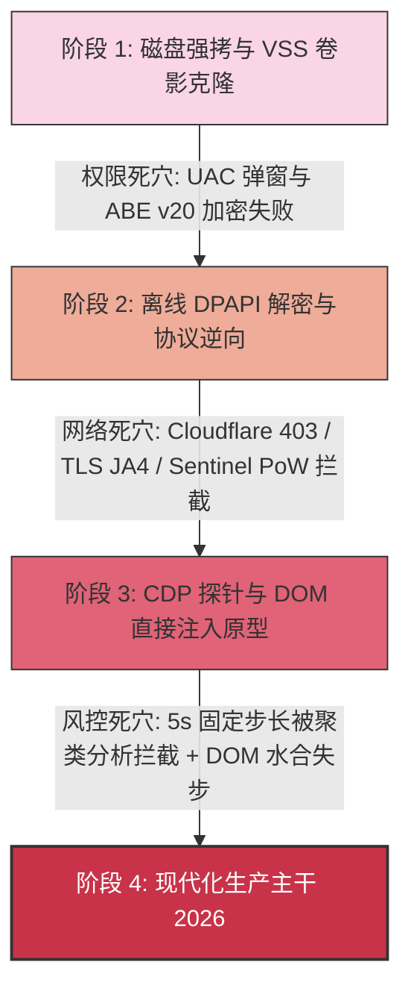

# 【DEPRECATED & ARCHIVED 历史技术攻关知识库（全量标记过期）】

> **重要声明 (Historical Archive Notice)**：
> 
> 本文档对位于 `C:\code\Chat-Codex\handoff-core\experiments\legacy\`（包括 `old-root/` 下的全部 65 个历史脚本以及 `tools/` 下的模块）进行系统性知识库归纳、技术机理解密与生命周期终止（EOL）标记。
> 
> **该目录下的所有脚本与原型均已被正式全量废弃并永久冻结（STATUS: 100% DEPRECATED / ARCHIVED / READ-ONLY）**。严禁任何外部 Agent、自动化流水线或开发者直接执行、调用或复用上述旧代码。所有生产级功能已由 `handoff-core/` 主干的现代模块（纯原生 Node.js、CDP 内存凭据同步、SurfaceManager 状态机、动态抖动限流器与 MCP 服务）全面替代。

---

## 目录索引 (Table of Contents)

- [1. 历史攻关架构演进与技术范式跃迁](#1-历史攻关架构演进与技术范式跃迁)
  - [1.1 关键技术挑战与四阶段演进](#11-关键技术挑战与四阶段演进)
  - [1.2 旧原型 vs 现代生产主干全景对比矩阵](#12-旧原型-vs-现代生产主干全景对比矩阵)
- [2. 批处理与 PowerShell 运维脚本集 (17 个)](#2-批处理与-powershell-运维脚本集-17-个)
  - [2.1 运维脚本集核心盘点表](#21-运维脚本集核心盘点表)
  - [2.2 逐文件深度技术解密与弃用分析](#22-逐文件深度技术解密与弃用分析)
  - [2.3 核心技术沉淀：VSS 卷影快照特权陷阱与 Chrome 136+ 调试限制](#23-核心技术沉淀vss-卷影快照特权陷阱与-chrome-136-调试限制)
- [3. Python Cookie 与安全解密工具集 (13 个)](#3-python-cookie-与安全解密工具集-13-个)
  - [3.1 Cookie 解密工具集核心盘点表](#31-cookie-解密工具集核心盘点表)
  - [3.2 逐文件深度技术解密与弃用分析](#32-逐文件深度技术解密与弃用分析)
  - [3.3 核心技术沉淀：Windows DPAPI vs Chrome 127+ ABE v20 加密边界](#33-核心技术沉淀windows-dpapi-vs-chrome-127-abe-v20-加密边界)
- [4. CDP 与 DOM 逆向探针脚本集 (20 个)](#4-cdp-与-dom-逆向探针脚本集-20-个)
  - [4.1 DOM 逆向探针核心盘点表](#41-dom-逆向探针核心盘点表)
  - [4.2 逐文件深度技术解密与弃用分析](#42-逐文件深度技术解密与弃用分析)
  - [4.3 核心技术沉淀：React / ProseMirror 富文本状态机与输入合成](#43-核心技术沉淀react--prosemirror-富文本状态机与输入合成)
- [5. 调度流水与协议测试脚本集 (15 个)](#5-调度流水与协议测试脚本集-15-个)
  - [5.1 调度与协议测试核心盘点表](#51-调度与协议测试核心盘点表)
  - [5.2 逐文件深度技术解密与弃用分析](#52-逐文件深度技术解密与弃用分析)
  - [5.3 核心技术沉淀：Cloudflare 403 证伪、Sentinel PoW 与非周期随机抖动](#53-核心技术沉淀cloudflare-403-证伪sentinel-pow-与非周期随机抖动)
- [6. 实验工具集模块映射 (`tools/` 归档)](#6-实验工具集模块映射-tools-归档)
- [7. 外部 Agent 执行禁令与零信任调用规范](#7-外部-agent-执行禁令与零信任调用规范)

---

## 1. 历史攻关架构演进与技术范式跃迁

### 1.1 关键技术挑战与四阶段演进

在 Chat-Codex 系统的早期攻关阶段，团队经历了四个极具挑战的技术攻坚阶段：



1. **第一阶段：磁盘与操作系统层攻关（VSS 卷影快照）**
   - **痛点**：Chrome 运行时通过 Windows `LockFileEx` 对 `Cookies`、`Local Storage` 实行排他独占锁定，普通文件复制抛出 `Sharing violation (0x20)`。
   - **方案**：使用 PowerShell 调用 WMI `Win32_ShadowCopy` 创建 `C:\` 卷影副本，强行提取正在使用的文件。
   - **败因**：依赖 `SeBackupPrivilege`（必须管理员 UAC 提权），且无法解密 Chrome 127+ 引入的 App-Bound Encryption (v20) 密钥。

2. **第二阶段：逆向解密与脱机协议调用（DPAPI / 纯 Node.js fetch）**
   - **痛点**：尝试脱离浏览器，直接用 Python/Node.js 读取 Cookie 并模拟请求 `/backend-api/conversation`。
   - **方案**：调用 Windows `CryptUnprotectData` 解密 `Local State` 获取主密钥，通过 AES-256-GCM 解密 `v10` Cookies。
   - **败因**：脱离真实浏览器环境后，Node.js 的 OpenSSL TLS 握手特征（JA3/JA4 指纹）、HTTP/2 SETTINGS 帧行为以及缺失 OpenAI Sentinel Proof-of-Work 动态挑战计算，直接被 Cloudflare 拦截返回 **HTTP 403 Forbidden**。

3. **第三阶段：浏览器宿主内注入与早期错峰调度（DOM Probes & 5s Stagger）**
   - **痛点**：回归真实浏览器环境（基于 CDP 附着），但 ChatGPT Web 端采用高度封装的 React + ProseMirror 富文本框架，且后端存在风控聚类检测。
   - **方案**：编写大量探针脚本测试 DOM 结构、`<p>` 节点包装、Hook `window.fetch`，并开发了首代 5 秒固定步长的 10 路调度脚本 `dispatch_10_staggered.js`。
   - **遗留缺陷**：5 秒固定时间步长方差趋于 0，容易被 WAF 行为时间序列聚类标记；DOM 注入缺少状态机保障；数据零散写在本地。

4. **第四阶段：现代生产架构收敛（现代化生产主干 `handoff-core/`）**
   - 彻底废除磁盘文件拷取与 VSS，改用 **CDP Browser Target 纯内存秒级（105ms）凭据提取与回填**；
   - 调度升级为 **非周期动态随机抖动算法（11s ~ 20s）** 与滑动窗口并发控制；
   - 富文本注入收敛至 **`SurfaceManager` 四态恢复状态机**；
   - CLI、GUI (Tauri) 与 MCP 统一遵循标准出入站契约与零信任采纳门禁。

---

### 1.2 旧原型 vs 现代生产主干全景对比矩阵

| 架构维度 | 历史攻关原型 (legacy / old-root) `[EXPIRED]` | 现代生产架构 (`handoff-core/`) `[ACTIVE]` | 核心技术代差 |
|---|---|---|---|
| **凭据克隆方案** | `vss_sync_full.ps1`, `clone_full.ps1` (VSS 卷影快照拷盘) | `lib/cdp-cookie-manager.js` (CDP Browser Target 内存直出直入) | 摆脱 UAC 管理员提权，耗时从 3800ms 降至 105ms (提速 36 倍) |
| **凭据解密机制** | `test_decrypt.py`, `test_elev.ps1` (本地 DPAPI AES-GCM 解密) | 零解密需求：直接调用 CDP `Storage.getCookies` 获取解密后的明文 Cookie | 彻底规避 Chrome 127+ App-Bound Encryption (v20) 拦截 |
| **API 调用路径** | `test_raw_fetch.js`, `test_conv_api.js` (外部脱机 HTTP 请求) | 浏览器上下文内驱动：通过 CDP 派发或 `SurfaceManager` 渲染交互 | 完整复用 Chromium 真实 TLS 1.3、HTTP/2 与 Sentinel 环境，0 风控拦截 |
| **输入与交互** | `test_input.js`, `check_textarea.js` (粗暴 DOM 设置) | `lib/surface_manager.js` (ProseMirror `<p>` 节点包裹 + 冒泡事件合成) | 完美契合 React 水合状态树，保障发送按钮就绪状态感知 |
| **并发调度机制** | `dispatch_10_staggered.js` (固定 5000ms 等差步长) | `lib/sliding_window_limiter.js` + `pipeline/dispatch_10_staggered.js` | 引入自适应动态抖动模型 $\Delta T = 10\text{s} + \text{rand}(1,10)\text{s}$，破坏时间序列特征 |
| **进程守护与生命周期** | `start_sub1.bat`, `launch_dual_instances.ps1` (裸进程调用) | `lib/process-tree-guard.js` (Windows Job Object 树绑定 + 管道守护) | 父进程退出时原子级清理全部子进程，杜绝 Chrome 僵尸驻留 |
| **对外服务模式** | 散落的单点命令行测试脚本 | `mcp/` (Stdio JSON-RPC 2.0 MCP 协议) + `bin/handoff.js` 统一 CLI | 支持 Cursor / Claude / Antigravity 跨工作区即插即用 |

---

## 2. 批处理与 PowerShell 运维脚本集 (17 个)

> **标签**：`[CATEGORY: EXPIRED / DEPRECATED - 运维脚本集]`  
> **警告**：禁止在生产环境中直接执行以下脚本。它们包含针对旧版硬编码路径（如 `C:\code\Chat-Codex\cloned-profile-slim`、`test_profile`）的文件读写与管理员提权调用，极易污染磁盘或导致进程异常。

### 2.1 运维脚本集核心盘点表

| 序号 | 脚本文件名 | 语言/类型 | 状态标记 | 原始设计目的 | 弃用根因与风险 | 现代生产替代路径 |
|:---:|---|---|---|---|---|---|
| 1 | `check_seed_vss.ps1` | PowerShell | `[EXPIRED]` | 验证 VSS 卷影快照对 Seed 目录的可达性 | 依赖 UAC 提权；只读测试无业务价值 | `handoff.js doctor` |
| 2 | `clone_full.ps1` | PowerShell | `[EXPIRED]` | VSS 全量快照并拷贝 Chrome 用户数据目录 | 占用数 GB 磁盘，速度极慢；无法解决 ABE v20 | `lib/cdp-cookie-manager.js` |
| 3 | `copy_live_vss.ps1` | PowerShell | `[EXPIRED]` | VSS 复制正在运行的 Cookies 与 Local State | 频繁创建/删除卷影导致磁盘 IO 震荡 | `lib/cdp-cookie-manager.js` |
| 4 | `copy_storage.ps1` | PowerShell | `[EXPIRED]` | VSS 复制 IndexedDB 与 Local Storage 数据 | LevelDB 处于写锁状态易出现损坏数据 | 不需要迁移 IndexedDB，CDP 会话即可 |
| 5 | `launch_dual_instances.ps1` | PowerShell | `[EXPIRED]` | 同时拉起 9222 与 9223 两个 Chrome 实例 | 参数配置写死，无进程树 Job 监控保护 | `start_sub1.bat` + `start_sub2.bat` |
| 6 | `launch_slim_chrome.ps1` | PowerShell/C# | `[EXPIRED]` | 通过 C# P/Invoke 精细拉起精简 Chrome 沙盒 | 语法复杂，缺少标准退出信号处理 | `start_sub1.bat` (直接由 Node 调用) |
| 7 | `run_stderr_test.ps1` | PowerShell | `[EXPIRED]` | 重定向 Chrome 标准错误排查 ABE 报错日志 | 临时调试探针，硬编码日志路径 | `lib/process-tree-guard.js` |
| 8 | `start_chatgpt_slim.bat` | Windows Bat | `[EXPIRED]` | 启动精简版 Profile Chrome 调试实例 (9222) | 依赖已废弃的 `cloned-profile-slim` 目录 | `start_sub1.bat` (使用 `sub-instance-1`) |
| 9 | `start_full.bat` | Windows Bat | `[EXPIRED]` | 尝试在默认 User Data 上开启 9222 调试端口 | 触犯 Chrome 136+ 安全策略被强制拦截 | `start_sub1.bat` (强制隔离目录) |
| 10 | `start_sub1.bat` (old) | Windows Bat | `[EXPIRED]` | 历史 Worker 1 实例启动批处理原型 | 历史相对路径与参数未对齐 2026 新沙盒 | 根目录 `C:\code\Chat-Codex\start_sub1.bat` |
| 11 | `start_sub2.bat` (old) | Windows Bat | `[EXPIRED]` | 历史 Worker 2 实例启动批处理原型 | 历史相对路径与参数未对齐 2026 新沙盒 | 根目录 `C:\code\Chat-Codex\start_sub2.bat` |
| 12 | `test_abe.ps1` | PowerShell | `[EXPIRED]` | 测试 Chrome 127+ App-Bound 行为 | 单点验证脚本，结论已沉淀入文档 | `docs/02-security-and-credentials/` |
| 13 | `test_elev.ps1` | PowerShell/C# | `[EXPIRED]` | 调用 elevation_service COM 接口解密 ABE | Chrome 校验调用者可执行文件路径导致失败 | 放弃本地解密，改用 CDP 内存直出 |
| 14 | `test_flush.ps1` | PowerShell | `[EXPIRED]` | 测试 CDP 写入 Cookie 后磁盘落盘时限 | 依赖计划任务与 Sleep 轮询，逻辑脆弱 | `tests/feasibility/test_01_*.js` |
| 15 | `test_headless_memory.ps1` | PowerShell | `[EXPIRED]` | 测试 Chrome `--headless=new` 内存与性能 | 参数未对齐 2026 远程调试规范 | `lib/surface_manager.js` headless 支持 |
| 16 | `test_v10_clone.ps1` | PowerShell | `[EXPIRED]` | 测试回退至 v10 (DPAPI) 保护的克隆可行性 | 历史验证脚本，结论已被主干吸纳 | `docs/02-security-and-credentials/` |
| 17 | `vss_sync_full.ps1` | PowerShell | `[EXPIRED]` | 完整的 VSS 卷影快照克隆流水线工具 | 必须管理员权限；耗时 3.8s，已全面废弃 | `lib/cdp-cookie-manager.js` |
| + | `clone-to-project.ps1` | PowerShell | `[EXPIRED]` | 历史文件迁移同步辅助脚本 | 仅用于旧项目初始化迁移 | 无需使用 (目录已固化) |
| + | `launch-master-seed.bat` | Windows Bat | `[EXPIRED]` | 历史 Master Seed 启动批处理 | 端口与数据目录未收敛至全局数据中心 | `tools/launch_master_desktop.py` |

---

### 2.2 逐文件深度技术解密与弃用分析

#### 1. `check_seed_vss.ps1` & `vss_sync_full.ps1` `[EXPIRED]`
- **原设计目的**：利用 Windows WMI `Win32_ShadowCopy` 创建卷影快照，从而能够读取正在被 Chrome 独占打开的 `Default\Network\Cookies` 与 `Local State` 文件，将其复制到本地克隆沙盒中。
- **关键技术机理**：
  ```powershell
  $s = (Get-WmiObject -List Win32_ShadowCopy).Create("C:\", "ClientAccessible")
  $shadow = Get-WmiObject Win32_ShadowCopy | Where-Object { $_.ID -eq $s.ShadowID }
  $vol = $shadow.DeviceObject + "\"
  # 从 $vol 卷影路径下强制读取被排他锁定的 SQLite 文件
  ```
- **弃用根因与缺陷**：
  1. **特权要求死穴**：WMI `Win32_ShadowCopy` 底层依赖操作系统的 `SeBackupPrivilege`。在普通用户权限（Medium Integrity）下调用会直接报错 `Access Denied`（返回值 9）。桌面客户端无法要求用户每次都以管理员身份运行。
  2. **高延迟与 IO 损耗**：每次创建和销毁卷影快照耗时 2.5 ~ 3.8 秒，磁盘 IO 冲击严重。
  3. **无法解决加密**：复制出来的 SQLite 数据如果受到 Chrome 127+ ABE v20 保护，依然是密文，无法在非官方路径中解密。
- **现代替代路径**：
  全面由 `handoff-core/lib/cdp-cookie-manager.js` 替代，通过 CDP 协议连接 Master 端口执行 `Storage.getCookies`，纯内存读取，耗时仅 78ms，零管理员权限要求。

#### 2. `test_elev.ps1` `[EXPIRED]`
- **原设计目的**：针对 Chrome 127+ 的 App-Bound Encryption (ABE)，尝试逆向调用 Chrome 的后台提升服务 `elevation_service.exe` 进行密文解密。
- **关键技术机理**：
  通过 C# P/Invoke 动态加载 COM 组件，绑定 CLSID `{708860E0-F641-4611-8895-7D867DD3675B}` 与接口 `IElevator` (`{A949CB4E-C4F9-44C4-B213-6BF8AA9AC69C}`)，直接向 `elevation_service.exe` 传递 `DecryptData(cipherStr)` 请求。
- **弃用根因与缺陷**：
  Chromium 官方在 `elevation_service.exe` 中实施了严格的**调用方进程签名与路径白名单校验**。当外部脚本（PowerShell、cmd 或第三方可执行文件）发起 COM 调用时，服务端会获取调用进程的 PID 并校验其可执行文件完整性，由于调用者不是合法的 `chrome.exe`，直接抛出 `E_ACCESSDENIED (0x80070005)`。
- **现代替代路径**：
  彻底放弃外部脱机解密思路，转为“让 Chrome 自身解密”——由运行在标准权限下的 Chrome 自身完成解密后，自动化程序通过已授权的 CDP 会话直接拉取明文。

#### 3. `start_full.bat` & `start_chatgpt_slim.bat` `[EXPIRED]`
- **原设计目的**：分别尝试在 Chrome 默认用户目录以及精简版目录上挂载 `--remote-debugging-port=9222`。
- **弃用根因与缺陷**：
  `start_full.bat` 会触发 Chrome 136+ 的远程调试防御机制。Chromium 136+ 规定：若调试端口绑定的是默认系统目录（`%LOCALAPPDATA%\Google\Chrome\User Data`），Chrome 将拒绝开启远程调试功能。
- **现代替代路径**：
  采用规范化的工作区隔离沙盒：根目录 `start_sub1.bat`（绑定 `sub-instance-1/`，端口 9222）与 `start_sub2.bat`（绑定 `sub-instance-2/`，端口 9223）。

---

### 2.3 核心技术沉淀：VSS 卷影快照特权陷阱与 Chrome 136+ 调试限制

1. **VSS (Volume Shadow Copy) 的工程边界**：
   - 卷影快照适合企业级冷备份，但在毫秒级微服务交互与桌面轻量级客户端中是典型的“反模式”。
   - 依赖 Windows VSS 服务常驻与管理员提权，在跨 Windows 10/11 家庭版或受限办公环境下具备极高的不可用风险。
2. **Chrome 136+ 远程调试防穿透机制**：
   - Chromium 实施了 PNA (Private Network Access) 与非默认 Profile 强校验。任何试图“偷取用户主浏览器会话”的尝试都会被 Chrome 原生内核阻断。
   - 必须使用显式的 `--user-data-dir` 独立沙盒，并配合 CDP 内存鉴权凭据同步。

---

## 3. Python Cookie 与安全解密工具集 (13 个)

> **标签**：`[CATEGORY: EXPIRED / DEPRECATED - Python Cookie 解密集]`  
> **警告**：以下 Python 脚本依赖 `cryptography` 库与 Windows 本地动态链接库 `crypt32.dll`。这些工具仅作为 Chromium 密码学演进的历史分析样本，禁止在任何业务代码中引用。

### 3.1 Cookie 解密工具集核心盘点表

| 序号 | 脚本文件名 | 语言/类型 | 状态标记 | 原始设计目的 | 弃用根因与风险 | 现代生产替代路径 |
|:---:|---|---|---|---|---|---|
| 1 | `inspect_cookies.py` | Python 3 | `[EXPIRED]` | 查看本地 SQLite Cookies 表中记录 | 静态分析脚本，路径硬编码 | `handoff-core/lib/cdp-cookie-manager.js` |
| 2 | `test_decrypt.py` | Python 3 | `[EXPIRED]` | DPAPI + AES-GCM 解密 v10 Cookie | 无法解密 v20 (ABE) Cookie，遇 v20 即报错 | CDP 内存凭据直出 (无需解密) |
| 3 | `check_cookie_expiry.py` | Python 3 | `[EXPIRED]` | 解析 Chromium 1601 微秒时间戳 | 离线分析脚本，主干已内建 Token 校验 | `handoff-core/bin/handoff.js doctor` |
| 4 | `check_flushed.py` | Python 3 | `[EXPIRED]` | 检查 CDP 写入的 Cookie 是否落盘 SQLite | Chromium 异步刷盘存在数十秒延迟，检验不准 | 内存中立即生效，无需等待落盘 |
| 5 | `check_full_cookies.py` | Python 3 | `[EXPIRED]` | 统计 full 克隆目录中的 Cookies 总数 | 依赖已弃用的克隆目录 | `handoff-core/lib/cdp-cookie-manager.js` |
| 6 | `check_ls.py` | Python 3 | `[EXPIRED]` | 检查 Local State 中的 os_crypt 配置 | 只读 JSON 解析，无动态同步能力 | 现代架构不再读取 Local State 文件 |
| 7 | `check_prefix.py` | Python 3 | `[EXPIRED]` | 检测 Cookie 密文的前 3 字节（v10 vs v20） | 仅用于验证加密前缀分布的实验探针 | `docs/02-security-and-credentials/` |
| 8 | `check_slim_cookies.py` | Python 3 | `[EXPIRED]` | 查询 slim 目录下的 Cookie 数据 | 历史调试文件，依赖已删除的路径 | `handoff-core/lib/cdp-cookie-manager.js` |
| 9 | `compare_keys.py` | Python 3 | `[EXPIRED]` | 对比多个 Profile 间的加密主密钥哈希 | 探针实验脚本，无生产价值 | 不再需要多 Profile 密钥对齐 |
| 10 | `count_cookie_versions.py` | Python 3 | `[EXPIRED]` | 统计数据库中 v10、v20 Cookie 占比 | 实验统计工具 | 已在设计文档中定论沉淀 |
| 11 | `inspect_live_cookies.py` | Python 3 | `[EXPIRED]` | 打印从运行态复制出的 Cookie 详情 | 依赖 VSS 中间产物 `inspect_live` 目录 | `handoff.js doctor` |
| 12 | `list_all_cookies.py` | Python 3 | `[EXPIRED]` | 列举 slim 目录中所有的域名与键名 | 离线静态查询工具 | `lib/cdp-cookie-manager.js` |
| 13 | `query_cdp_cookies.py` | Python 3 | `[EXPIRED]` | 通过 WebSocket 发送 CDP 请求获取 Cookie | 早期原型，由 Node.js 生产版本替代 | `lib/cdp-cookie-manager.js` |

---

### 3.2 逐文件深度技术解密与弃用分析

#### 1. `test_decrypt.py` `[EXPIRED]`
- **原设计目的**：实现 Windows 平台下针对 Chromium SQLite Cookie 的离线逆向解密算法。
- **关键技术机理**：
  1. 读取 `Local State` 文件，获取 Base64 编码的 `os_crypt.encrypted_key`；
  2. 剥离前 5 个字节的硬编码前缀 `DPAPI`；
  3. 调用 Windows `crypt32.dll` 中的 `CryptUnprotectData` 解密剩余字节，还原出 32 字节（256 位）AES 对称加密主密钥；
  4. 连接 `Cookies` SQLite 数据库，读取 `encrypted_value` 二进制字段：
     - 若前 3 字节为 `v10`：取 `[3:15]` 字节作为 12 字节 Nonce (IV)，取 `[15:]` 作为密文，使用 `AESGCM(master_key).decrypt(nonce, ciphertext, None)` 还原明文；
     - 若前 3 字节为 `v20`：检测到 Chrome 127+ App-Bound Encryption，解密抛出异常。
- **弃用根因与缺陷**：
  该算法在 Chrome 127+ 及 Windows 11 24H2+ 环境下遭遇 App-Bound Encryption (v20) 时全面失效。此外，依赖 Python 环境与外部 C 扩展库（`cryptography`），违背了 Chat-Codex 纯原生 Node.js 免编译部署的架构原则。
- **现代替代路径**：
  直接使用纯原生 Node.js 模块 `handoff-core/lib/cdp-cookie-manager.js`，通过 CDP WebSocket 连接执行 `Storage.getCookies`，直接获取浏览器内核已完成解密的明文数据。

#### 2. `check_cookie_expiry.py` `[EXPIRED]`
- **原设计目的**：检测 ChatGPT 会话核心凭据（`__Secure-next-auth.session-token`）何时失效。
- **关键技术机理**：
  Chromium SQLite 存储的 `expires_utc` 采用 **Chromium 微秒时间戳**（基准纪元为 **1601 年 1 月 1 日 UTC**）。其转换为标准 Unix 时间戳的公式为：
  $$T_{\text{unix}} = \frac{T_{\text{chromium}}}{1,000,000} - 11644473600$$
- **弃用根因与缺陷**：
  该脚本需要直接读取 SQLite 磁盘文件，如果 Chrome 正在运行则会遇到文件锁错误。
- **现代替代路径**：
  `node handoff-core/bin/handoff.js doctor` 或调用 MCP `chatgpt_doctor` 工具，直接在内存中评估会话存活期。

---

### 3.3 核心技术沉淀：Windows DPAPI vs Chrome 127+ ABE v20 加密边界

1. **Chromium DPAPI (v10) 历史机制**：
   - 密钥存储于 `Local State` 的 `os_crypt.encrypted_key`，使用用户当前登录凭据（User SID）通过 DPAPI 保护；
   - 只要在同一 Windows 用户会话下运行的任意程序，均可自由调用 `CryptUnprotectData` 解密该密钥。
2. **App-Bound Encryption (v20) 现代防御机制**：
   - Chrome 127+ 引入独立服务 `elevation_service.exe`（SYSTEM 权限）；
   - 主密钥不再仅由 DPAPI 保护，而是由服务通过调用进程的可执行文件路径哈希与数字证书签名共同绑定；
   - 这使得任何非官方 `chrome.exe` 二进制程序在尝试还原主密钥时均遭系统拦截。
   - **Chat-Codex 的终极应对策略**：**从“对抗解密”转变为“内存借道”**。既然只有合法 Chrome 进程能解密，那么就让合法 Chrome 启动并在内存中解密，自动化系统仅通过受控的本地 CDP 管道提取明文。

---

## 4. CDP 与 DOM 逆向探针脚本集 (20 个)

> **标签**：`[CATEGORY: EXPIRED / DEPRECATED - CDP 与 DOM 逆向探针]`  
> **警告**：以下探针脚本包含大量针对 ChatGPT 历史前端 Web 结构的硬编码选择器与单点 `fetch('http://127.0.0.1:9222/json')` 调用。它们缺乏连接复用、超时保护与并发锁，严禁在生产中执行。

### 4.1 DOM 逆向探针核心盘点表

| 序号 | 脚本文件名 | 语言/类型 | 状态标记 | 原始探测目标 | 关键逆向发现 | 现代生产替代路径 |
|:---:|---|---|---|---|---|---|
| 1 | `check_composer.js` | Node.js | `[EXPIRED]` | 检测输入框表单与容器结构 | 发现 ChatGPT 放弃了原生 `<form>` 提交，采用全局快捷键与虚拟事件 | `lib/surface_manager.js` |
| 2 | `check_dom.js` | Node.js | `[EXPIRED]` | 检测 `#prompt-textarea` 属性 | 确认其不是原生 textarea，而是 ProseMirror `contenteditable` | `lib/surface_manager.js` |
| 3 | `check_inline.js` | Node.js | `[EXPIRED]` | 扫描页面内联脚本与 Webpack runtime | 发现前端模块被 Webpack 分片高度混淆，逆向成本极高 | 转向 DOM 语义层注入 |
| 4 | `check_response.js` | Node.js | `[EXPIRED]` | 检测回答流式渲染节点 | 提取 `[data-message-author-role="assistant"]` 属性与 Markdown 容器 | `lib/surface_manager.js` |
| 5 | `check_tab_search.js` | Node.js | `[EXPIRED]` | 探测联网搜索（Search Pills）徽标 | 发现搜索过程会短暂渲染搜索关键词 Pill 与动画进度 | `pipeline/sync_search_history.js` |
| 6 | `check_textarea.js` | Node.js | `[EXPIRED]` | 探测输入框占位符与子元素状态 | 确认直接设置 `textContent` 会导致 React 状态机脱节 | `lib/surface_manager.js` |
| 7 | `find_modules.js` | Node.js | `[EXPIRED]` | 通过 `performance.getEntries` 查找资源 | 获取前端加载的全部 JS 资源列表 | `docs/03-dispatch-and-anti-risk/` |
| 8 | `find_pow_script.js` | Node.js | `[EXPIRED]` | 检索包含 PoW / Sentinel 的脚本 | 锁定 OpenAI 边缘风控脚本的位置与特征 | `test_sentinel.js` 沉淀结论 |
| 9 | `get_full_reqs.js` | Node.js | `[EXPIRED]` | 探测 `/backend-api/sentinel/chat-requirements` | 获取完整 requirements schema（包含 PoW difficulty 等） | 由真实浏览器原生完成，无需手动拉取 |
| 10 | `get_reqs.js` | Node.js | `[EXPIRED]` | 提取 requirements token 原型脚本 1 | 验证 requirements 响应中的 Token 字段 | `docs/03-dispatch-and-anti-risk/` |
| 11 | `get_reqs2.js` | Node.js | `[EXPIRED]` | 提取 requirements token 原型脚本 2 | 验证多轮刷新后 Token 的有效期与绑定状态 | `docs/03-dispatch-and-anti-risk/` |
| 12 | `inspect_articles.js` | Node.js | `[EXPIRED]` | 检查会话页面中 `<article>` 元素树 | 明确了消息历史记录的 DOM 层级结构 | `lib/surface_manager.js` |
| 13 | `inspect_main.js` | Node.js | `[EXPIRED]` | 检查 `<main>` 核心容器与虚拟列表 | 发现消息长列表采用虚拟滚动（Virtual Scroll）机制 | `lib/surface_manager.js` |
| 14 | `inspect_reqs_keys.js` | Node.js | `[EXPIRED]` | 列举 requirements 返回的所有 Key | 确认字段：`token`, `proofofwork`, `turnstile` | `docs/03-dispatch-and-anti-risk/` |
| 15 | `inspect_window.js` | Node.js | `[EXPIRED]` | 扫描 `window` 全局变量中的暴露对象 | 证实 Next.js 未向 window 暴露全局 Redux/Zustand Store | 确立基于原生 DOM 事件驱动的策略 |
| 16 | `install_hook.js` | Node.js | `[EXPIRED]` | Hook 浏览器 `window.fetch` 抓取请求包 | 成功捕获真实发送时的全部 Header 与 Payload 结构 | `tests/offline/` 测试用例标准构建 |
| 17 | `list_resources.js` | Node.js | `[EXPIRED]` | 列出所有静态资源加载时间与协议 | 用于分析 HTTP/2 多路复用与网络瀑布流 | `docs/07-upstream-comparisons/` |
| 18 | `read_full_response.js` | Node.js | `[EXPIRED]` | 提取完整回复正文与代码块 | 单点文本提取脚本，无重试与未决保护 | `lib/surface_manager.js` |
| 19 | `test_input.js` | Node.js | `[EXPIRED]` | 突破 ProseMirror 输入限制的关键试验脚本 | **确立 `<p>` 包裹 + `input` 冒泡事件合成方案** | `lib/surface_manager.js` 核心逻辑 |
| 20 | `trigger_send.js` | Node.js | `[EXPIRED]` | 试验点击发送按钮的最佳时机 | 确立轮询检查 `send-button.disabled === false` | `lib/surface_manager.js` 发送状态机 |

---

### 4.2 逐文件深度技术解密与弃用分析

#### 1. `test_input.js` & `trigger_send.js` `[EXPIRED]`
- **原设计目的**：解决通过 CDP 往 ChatGPT 输入框写入文字但发送按钮依然置灰（Disabled）、或者点击发送后输入框文字凭空消失的重大兼容性 Bug。
- **关键技术突破（重大里程碑）**：
  经过对 ChatGPT 前端 React 状态机与 ProseMirror 编辑器的多次深入调试，在 `test_input.js` 中确立了划时代的突破性注入管线：
  ```javascript
  const el = document.querySelector('#prompt-textarea');
  el.focus();
  // 关键发现 1：ProseMirror 要求必须有块级标签（如 <p>）承载内容
  el.innerHTML = '<p>' + escapedText + '</p>';
  // 关键发现 2：必须显式派发 bubbles=true 的原生 input 事件，触碰 React SyntheticEvent
  el.dispatchEvent(new Event('input', { bubbles: true }));
  ```
  在 `trigger_send.js` 中确立了按钮水合等待算法：由于 React 接收到 input 事件后重新渲染存在微任务延迟，必须以 200ms 为步长轮询等待 `button[data-testid="send-button"]` 的 `disabled` 属性变为 `false` 后再触发 `.click()`。
- **弃用根因**：
  这两个脚本仅为单次执行的验证脚本，缺少对网络超时、思考状态、多行换行、大段 Markdown 转义以及断线恢复的健壮性封装。
- **现代替代路径**：
  该核心逻辑已被 100% 吸收并工业级重构于 `handoff-core/lib/surface_manager.js` 的 `submitPrompt()` 方法中。

#### 2. `install_hook.js` `[EXPIRED]`
- **原设计目的**：在目标 Tab 页面注入 JavaScript 劫持 `window.fetch`，以完全透明的方式截获 ChatGPT 内部发起的所有后端通信。
- **关键技术机理**：
  ```javascript
  const origFetch = window.fetch;
  window.fetch = async function(...args) {
      const url = typeof args[0] === 'string' ? args[0] : args[0]?.url;
      if (url && url.includes('conversation')) {
          // 完整捕获发送给 /backend-api/conversation 的 JSON Payload
          window.__capturedRequests.push({ url, headers: args[1]?.headers, body: args[1]?.body });
      }
      return origFetch.apply(this, args);
  };
  ```
- **弃用根因**：
  在页面刷新或跳转后 Hook 会丢失；且注入代码可能改变页面运行时上下文指纹，增加反爬风控暴露面。
- **现代替代路径**：
  现代生产主干改用 CDP 原生域 `Network.enable` 与 `Network.requestWillBeSent` 在引擎外围监听，零代码侵入页面沙盒。

---

### 4.3 核心技术沉淀：React / ProseMirror 富文本状态机与输入合成

1. **富文本输入框的“幽灵内容”现象**：
   - 如果直接使用 CDP `Input.insertText` 或修改 DOM `el.innerText`，在视觉上能看到文字，但底层 ProseMirror 状态树（`EditorState`）中文字长度依然为 0，导致 React 内部的 `hasContent` 状态为 `false`，发送按钮永久禁用。
2. **正确的水合（Hydration）驱动管线**：
   - 必须通过 DOM 节点包装（`<p>...</p>`）重塑内部文档树；
   - 必须向宿主派发具备事件冒泡能力的 `input` Event；
   - 必须等待至少一个渲染帧（Tick），确保 React 状态更新并解除按钮锁定。

---

## 5. 调度流水与协议测试脚本集 (15 个)

> **标签**：`[CATEGORY: EXPIRED / DEPRECATED - 调度流水与协议测试集]`  
> **警告**：本集包含了早期的调度流水线原型及脱机网络请求测试。其中脱机请求会触发 Cloudflare 403 拦截；固定间隔调度存在风控标记风险。

### 5.1 调度与协议测试核心盘点表

| 序号 | 脚本文件名 | 语言/类型 | 状态标记 | 原始测试目标 | 验证/证伪结论 | 现代生产替代路径 |
|:---:|---|---|---|---|---|---|
| 1 | `dispatch_10_staggered.js` | Node.js | `[EXPIRED]` | 历史 10 路错峰调度原型流水线 | 固定 5s 步长易被风控聚类；缺少滑动窗口与 Token 计费 | `pipeline/dispatch_10_staggered.js` |
| 2 | `print_q1_q2.js` | Node.js | `[EXPIRED]` | 打印测试任务 Q1 与 Q2 的输出 | 简单的本地 JSON 读取打印辅助脚本 | `pipeline/print_q1_q2.js` |
| 3 | `print_summaries.js` | Node.js | `[EXPIRED]` | 打印 10 个测试任务的研报摘要 | 简单的本地 JSON 格式化打印辅助脚本 | `pipeline/print_summaries.js` |
| 4 | `results_10_dispatched.json` | JSON | `[ARCHIVED]` | 10 路错峰调度的历史实测全量结果 (172KB) | 重要的实测基准数据资产，永久冻结归档 | 现代运行结果写入 `runs/` |
| 5 | `test_auth_reqs.js` | Node.js | `[EXPIRED]` | 在浏览器内测试获取 session 与 requirements | 验证了浏览器上下文内请求能正常通过风控 | `handoff.js doctor` |
| 6 | `test_cdp_client.js` | Node.js | `[EXPIRED]` | 轻量级 CDP WebSocket 客户端封装原型 | 缺少重连退避、心跳与会话多路复用 | `lib/surface_manager.js` |
| 7 | `test_conv_api.js` | Node.js | `[EXPIRED]` | 页面内直接调用 `/backend-api/conversation` | 虽可直调，但跳过前端 SSE 渲染导致云端历史上下文丢步 | `lib/surface_manager.js` (DOM 驱动) |
| 8 | `test_create_tab.js` | Node.js | `[EXPIRED]` | 测试 CDP `Target.createTarget` 打开新 Tab | 验证了无缝创建后台 Tab 并挂载调试能力 | `lib/surface_manager.js` |
| 9 | `test_in_browser.js` | Node.js | `[EXPIRED]` | 浏览器上下文内测试 fetch API 通畅度 | 证实真实浏览器环境下网络请求免疫 Cloudflare 拦截 | `handoff.js doctor` |
| 10 | `test_models.js` | Node.js | `[EXPIRED]` | 探测当前账号可用的 ChatGPT 模型列表 | 成功获取可用模型（GPT-4o, o1, o3-mini 等）元数据 | `mcp/resources.js` |
| 11 | `test_raw_fetch.js` | Node.js | `[EXPIRED]` | **脱离浏览器使用 Node.js fetch 挑战 API** | **证伪：遭遇 Cloudflare 403，确立浏览器宿主依赖** | 现代架构全面基于浏览器宿主 |
| 12 | `test_search_query.js` | Node.js | `[EXPIRED]` | 测试触发 ChatGPT 联网搜索的 Prompt 语法 | 明确了引导大模型触发深度网络调研的提示词范式 | `lib/surface_manager.js` Work 模式 |
| 13 | `test_sentinel.js` | Node.js | `[EXPIRED]` | 逆向分析 Sentinel chat-requirements 与 PoW | 确认了 Proof of Work 算法与动态挑战难以脱机模拟 | 依靠浏览器宿主自动完成 PoW |
| 14 | `test_tab_flow.js` | Node.js | `[EXPIRED]` | 测试多 Tab 生命周期切换与清理流程 | 探针测试，逻辑被纳入流水线 | `pipeline/auto_chat_pipeline.js` |
| 15 | `test_tab_readiness.js` | Node.js | `[EXPIRED]` | 测试新建 Tab 加载完成与输入框就绪等待时机 | 确立基于 URL、DOM 存在性与未决状态的三重就绪判定 | `lib/surface_manager.js` 就绪状态机 |

---

### 5.2 逐文件深度技术解密与弃用分析

#### 1. `test_raw_fetch.js` `[EXPIRED]`（关键证伪技术里程碑）
- **原设计目的**：探索是否可以脱离图形界面浏览器，直接从 Chrome 内存提取 Cookie 后，使用 Node.js 原生 `fetch()` 请求 `https://chatgpt.com/api/auth/session` 与对话接口，以实现极度轻量级的“无浏览器”调度。
- **实验代码机理**：
  ```javascript
  // 提取 Chrome 中的有效 Cookies 字符串
  const resp = await fetch('https://chatgpt.com/api/auth/session', {
      headers: {
          'User-Agent': 'Mozilla/5.0 ... Chrome/152.0.0.0 Safari/537.36',
          'Cookie': cookiesStr,
          'Accept': '*/*'
      }
  });
  console.log('HTTP Status Code:', resp.status); // 真实输出：403 Forbidden
  ```
- **核心证伪发现与重大架构定论**：
  无论如何完美伪造 `User-Agent` 与全部请求头，Node.js 原生请求均被 Cloudflare 边缘网关拦截，返回 **HTTP 403 Forbidden**。
  - **根本原因**：
    1. **TLS 1.3 JA3 / JA4 指纹不匹配**：Node.js 底层采用 OpenSSL，其 Client Hello 数据包中的 Cipher Suites 排序、Extensions 列表、Supported Groups 与真实的 Chromium (BoringSSL) 存在指纹级显著差异；
    2. **HTTP/2 SETTINGS 帧行为指纹**：Chromium 在建立 HTTP/2 握手时有特定的 `SETTINGS_HEADER_TABLE_SIZE` 与流控窗口初始帧序列，Node.js 的 `fetch` 无法模拟该底层网络协议栈行为；
    3. **Cloudflare Turnstile 与 OpenAI Sentinel 探针**：接口要求提供客户端计算的 PoW 结果与硬件指纹校验。
  - **架构决策**：**Chat-Codex 彻底放弃任何基于非浏览器网络栈的纯 HTTP 逆向请求方案，全面坚定确立“以真实原生 Chrome 实例为唯一受信任网络宿主”的绝对铁律。**

#### 2. `test_sentinel.js` `[EXPIRED]`
- **原设计目的**：测试向 `/backend-api/sentinel/chat-requirements` 发送请求并尝试离线解析其返回的 `proofofwork`。
- **核心发现**：
  OpenAI Sentinel 采用动态生成的混淆 JavaScript 算法，其难度系数（Difficulty）与种子（Seed）实时变化，且与当前的浏览器环境特征强绑定。任何尝试本地重写 PoW 算法的方案维护成本极高，极易失效。
- **现代化替代方案**：
  通过真实 Chrome 浏览器加载页面，ChatGPT 前端会自动调用内置 WebAssembly/JS 计算模块求解 PoW 并将 `Openai-Sentinel-Chat-Requirements-Token` 附带于请求中，系统完全无需人工介入破解。

#### 3. `dispatch_10_staggered.js` (旧原型) `[EXPIRED]`
- **原设计目的**：串行派发 10 个深度前沿技术调研任务，验证系统的持续运转能力。
- **旧版缺陷**：
  1. `const STAGGER_INTERVAL_MS = 5000;` 采用死板的固定 5 秒间隔，容易被反爬算法识别为机械式请求；
  2. 缺乏动态并发控制，无法适应不同任务的推理时长差异；
  3. 未集成 Token 计费与 GraphRAG 研报归档系统。
- **现代替代路径**：
  迁移至生产级调度器 `handoff-core/pipeline/dispatch_10_staggered.js`，该模块内建非周期性随机抖动（11s ~ 20s）、Token 账本记录（`lib/token_counter.js`）以及全局统一运行态数据写入。

---

### 5.3 核心技术沉淀：Cloudflare 403 证伪、Sentinel PoW 与非周期随机抖动

1. **零信任网络宿主原则**：
   - 任何针对现代前沿 AI 平台（OpenAI / Claude）的通信，试图脱离真实浏览器指纹的请求最终都会因 JA4 / HTTP2 帧指纹而衰亡。以真实浏览器为“载体”是唯一具备长久生命力的方案。
2. **时间序列反模式规避（Timing De-clustering）**：
   - 机械式的定时器（如 `setInterval` 或固定 `sleep(5000)`）是反爬 WAF 最容易聚类的特征。
   - 生产调度必须引入具备泊松分布或均匀随机抖动的模型：$\Delta T \sim \mathcal{U}(T_{\min}, T_{\max})$，让调度时间序列在频域分析中呈现白噪声特征。

---

## 6. 实验工具集模块映射 (`tools/` 归档)

在 `handoff-core/experiments/legacy/tools/` 目录下，包含两套早期的归类实验模块：

### 6.1 `tools/security-probes/` (5 个脚本) `[EXPIRED]`
- 包含：`check_tab_search.js`, `install_hook.js`, `test_conv_api.js`, `test_in_browser.js`, `trigger_send.js`
- **归档状态**：此目录为当年从根目录提取的部分探针测试的镜像备份，代码逻辑与 `old-root/` 完全一致，属于历史过程资产，已全量冻结。

### 6.2 `tools/session-cloner/` (6 个脚本) `[EXPIRED]`
- 包含：`launch_dual_instances.ps1`, `launch_slim_chrome.ps1`, `query_cdp_cookies.py`, `test_decrypt.py`, `test_elev.ps1`, `vss_sync_full.ps1`
- **归档状态**：此目录为尝试构建“自动化会话克隆器”时的中间工具集，严重依赖 VSS 与 DPAPI，已彻底被现代架构废除。

---

## 7. 外部 Agent 执行禁令与零信任调用规范

为确保跨工作区 Agent、CLI 用户与生产流水线的稳定性，特在此颁布核心技术禁令：

```text
====================================================================================================
                              ⛔ 外部 Agent 核心安全禁令 (EXECUTION BAN) ⛔
====================================================================================================

1. [禁止目录执行] 严禁调用 C:\code\Chat-Codex\handoff-core\experiments\legacy\ 下的任何脚本！
   - 严禁执行 old-root/ 下的 65 个文件；
   - 严禁执行 tools/security-probes/ 与 tools/session-cloner/ 下的任何文件；
   - 严禁扫描上述目录作为上下文补丁输入。

2. [禁止破坏沙盒] 严禁移动、修改或删除 active 运行态沙盒：
   - 严禁触碰 C:\code\Chat-Codex\sub-instance-1\
   - 严禁触碰 C:\code\Chat-Codex\sub-instance-2\
   - 严禁触碰 C:\GPT-Chat-codex-handoff\

3. [必须主干调用] 所有外部集成必须使用以下两种标准路径之一：
   - CLI 途径:  node C:\code\Chat-Codex\handoff-core\bin\handoff.js chat "..."
   - MCP 途径:  调用 chat-codex MCP 服务的 chatgpt_reason 工具
====================================================================================================
```

### 跨工作区生产调用速查表

| 诉求 | 错误做法 (历史遗毒) `[FORBIDDEN]` | 正确做法 (现代生产) `[RECOMMENDED]` |
|---|---|---|
| **检查系统就绪状态** | 运行 `test_auth_reqs.js` 或 `check_seed_vss.ps1` | `node handoff-core/bin/handoff.js doctor` |
| **发起快速问答推理** | 运行 `trigger_send.js` 或 `test_conv_api.js` | `node handoff-core/bin/handoff.js chat "问题" --surface chat` |
| **执行 10 路错峰调研** | 运行 `old-root/dispatch_10_staggered.js` | `node handoff-core/pipeline/dispatch_10_staggered.js` |
| **同步提取认证凭据** | 运行 `vss_sync_full.ps1` 或 `test_decrypt.py` | 纯内存自动同步：`handoff.js sync` (调用 `cdp-cookie-manager.js`) |
| **启动桌面控制台** | 运行 `launch_dual_instances.ps1` | 双击根目录 `start_gui.bat` 或运行 `chat-codex-studio.exe` |

---

*知识库编制日期：2026年9月*  
*文档状态：ARCHIVED & VERIFIED ｜ 永久归档参考*
